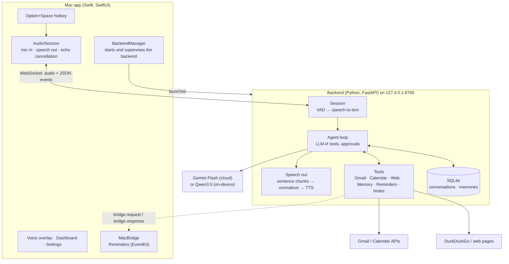

# Architecture

How Personal Agent fits together, and why it's built this way. Read this before changing
anything bigger than a tool.

## The big picture

Two processes on your Mac, talking over one local WebSocket:



**Why two processes?** The machine-learning stack (MLX models for speech in, speech out and
the local LLM) lives in Python. The things that need to feel native (a global hotkey, low-latency
audio with echo cancellation, a menu-bar app, macOS privacy permissions) live in Swift. The
app launches the backend and restarts it if needed, so a crash in the ML stack never takes the
UI down.

## Where things live

```
MacApp/
  App/          app entry, AppState (all UI state), BackendManager (AppLifecycle.swift)
  Agent/        WebSocket client and the message types (mirrors backend/api/schemas.py)
  Audio/        AVAudioEngine capture and playback, echo cancellation with a half-duplex fallback
  System/       global hotkey; MacBridge and Reminders (native APIs the backend asks for)
  UI/           voice overlay, dashboard, approval sheet, tool activity, settings
backend/
  api/          FastAPI app, the WebSocket session, protocol schemas, setup endpoints
  agent/        the agent loop, tool framework, prompts, conversations
  tools/        one file per integration: gmail, calendar, web, memory, reminders, notes, system
  voice/        VAD, speech-to-text, LLM providers (Gemini, MLX), TTS, speech normalization
  integrations/ Google OAuth
  memory/       saved facts ("remember that…")
  db.py         SQLite connection and migrations
  config.py     settings (override in .env.local)
scripts/        model download, smoke test
project.yml     XcodeGen project definition (the Xcode project is generated from it)
install.sh      one-command install
```

## A voice turn, end to end

1. **Option+Space** opens the mic. The app streams 16 kHz mono PCM16 audio over the WebSocket.
2. **Voice activity detection** (Silero VAD) finds where speech starts and ends. An utterance
   ends after 700 ms of silence. While you talk, a partial transcript is sent every 0.5 s.
3. **Speech-to-text** (NVIDIA Parakeet, on-device) produces the final transcript (~60 ms).
4. The **agent loop** runs a turn (below). Reply text streams to the dashboard as it's written.
5. **Speech out:** the reply is cut into sentences as it streams. Times, dates, money and
   numbers are turned into words ("10:03" → "ten oh three"), then the TTS engine (Kokoro by
   default) synthesizes each sentence while the LLM is still writing the next. Audio streams
   back to the app, which plays it at 1.2×.
6. **Barge-in:** if you start talking while it speaks, the backend tells the app to stop playback
   and cancels the turn. While the assistant is speaking, it takes 400 ms of speech (instead of
   200 ms) to count, so leftover echo doesn't interrupt it.

Typical timing, warm: about 1 second from the end of your speech to the first spoken word with
the local brain; Gemini adds network time.

## The agent loop

`backend/agent/agent.py`. For each user message:

1. Build the prompt: the system prompt (rules, the user's name, saved memories), then the
   conversation's last 40 messages. Old tool results are shortened. The current time is stamped
   on each user message rather than in the system prompt, so the system prompt never changes
   and its processed form can be cached.
2. Stream the LLM's reply. Visible text goes straight to the user; tool calls are collected.
3. If there are tool calls, run them, add the results to the conversation, and go back to step 2.
   At most 6 steps; on the last one, tools are withheld so the model has to answer.

Details that matter:
- **Two tool-call formats.** Gemini returns structured function calls (each with an opaque
  "thought signature" that must be sent back on the next request). The local Qwen model writes
  XML-style markup, which a streaming parser (`toolcalls.py`) holds back so it's never shown or
  spoken.
- **"Let me check…" and stop.** If the local model announces an action without calling a tool,
  the turn is continued with the start of a tool call forced.
- **Gemini overload.** Free-tier Flash is often busy. If it hasn't started answering within 6 s,
  the request moves to Flash-Lite (only if nothing has been spoken yet), and Flash is skipped
  for the next 5 minutes.

## Tools and permissions

`backend/agent/tools.py`. Every capability is a `Tool`: a Pydantic model for its arguments, an
async function, a permission level, a timeout, and a short label for the dashboard.

| Level | Meaning | Examples |
|---|---|---|
| `READ` | Runs freely; several reads in one step run in parallel | search Gmail, list events, web search |
| `WRITE` | Runs freely; small, reversible changes | draft an email, add a reminder, create a note in its own folder |
| `APPROVAL` | Pauses until the user approves (button or "yes" / "send it") | send email, change the calendar, delete a reminder |
| `FORBIDDEN` | Never runs | |

A tool can also ask for approval itself when the decision depends on the arguments.
The Notes tools do this: notes in the assistant's own folder are free, the user's other notes
ask every time, and that check is enforced in the script, not left to the model.

The registry turns every outcome into a result the model can read: bad arguments, timeouts and
errors included. Failed actions are marked `"done": false` so the model doesn't report them as
done. Results that contain third-party text (email, web pages, notes) are wrapped as
**untrusted**, and the system prompt says never to follow instructions found in them. Together
with approvals, this means a malicious email can't make the assistant send anything on its own.

### Adding a tool

1. Write it in `backend/tools/<name>.py`: an arguments model, an async function, and a
   `<name>_tools()` that returns `Tool(...)` entries. Copy the shape of `system.py` or `memory.py`.
2. Register it in `backend/api/server.py` (`tools.register(...)`).
3. Add a test in `backend/tests/` (see `test_tools.py` for a scripted LLM driving a tool call).

If it needs a native macOS API, see the bridge below.

## The bridge to the Mac app

Some things only the app can do. EventKit is a native API, and macOS grants privacy permissions
(Reminders, Contacts) to an app, not to a Python process. A tool calls

```python
await ctx.mac("reminders.create", title="Call mom", due=..., timed=True)
```

The backend sends `bridge.request` (with a request ID, method and JSON params) over the existing
WebSocket. `MacApp/System/MacBridge.swift` routes it by method name (`reminders.*` →
`Reminders.swift`) and replies with `bridge.response`. The backend waits until the reply arrives,
the turn is cancelled, or 60 s pass, which is long enough to answer a first-time permission prompt.

Apple Notes doesn't go through the bridge: it has no API besides Apple Events, so the Notes tools
run JavaScript for Automation with `osascript` from the backend. Arguments are passed as one JSON
string, never spliced into the script.

## The WebSocket protocol

`backend/api/schemas.py`, mirrored in `MacApp/Agent/MessageTypes.swift`. Keep them in sync.

- **App → backend:** `session.start`, `user.message` (typed), `audio.start` / `audio.stop` and
  binary mic audio, `conversation.cancel`, `approval.response`, `bridge.response`.
- **Backend → app:** `session.ready`, `input.speech_started`, `transcript.partial` / `.final`,
  `agent.thinking`, `tool.started` / `.completed`, `assistant.text.delta` / `.final`,
  `assistant.audio.start` / `.end` and binary reply audio, `approval.required` / `.resolved`,
  `draft.updated`, `system.open_url`, `bridge.request`, `error`.

The server only listens on 127.0.0.1, and every request needs a token that the backend writes to
`~/Library/Application Support/PersonalAgent/agent.token` on first run.

## Conversations and memory

- **SQLite** at `~/Library/Application Support/PersonalAgent/database.sqlite`. Migrations are a
  list in `backend/db.py`, tracked with `PRAGMA user_version`; append new ones, never edit old ones.
- Every message is saved as it happens, as the full message JSON, so tool calls replay exactly
  after a restart. The model sees the last 40; the database keeps everything.
- Opening the mic after 5 minutes of silence starts a new conversation.
- **Memories** are saved only when the user asks. All of them go into the system prompt; at
  personal scale that's simpler and more reliable than a search index.

## Models

| Job | Model | Why |
|---|---|---|
| Speech-to-text | NVIDIA Parakeet TDT 0.6B v3 (MLX) | More accurate than Whisper on English and much faster |
| Voice activity | Silero VAD | Small, reliable, runs on every 32 ms of audio |
| Voice (default) | Kokoro-82M | Not autoregressive, so it can't ad-lib laughs or loop; 6 s of speech in ~0.2 s |
| Voice (expressive) | Qwen3-TTS 1.7B | More natural, but occasionally adds laughs or drawn-out words |
| Brain (default) | Gemini Flash, Flash-Lite fallback | Much better at multi-step tool use; free tier |
| Brain (local) | Qwen3.5 9B, 4-bit (MLX) | Private and offline, but weaker |

All on-device models run on **one MLX worker thread** (`voice/mlx_runtime.py`): MLX streams are
per thread and the models aren't thread-safe. Jobs advance one step at a time, so the voice can
speak sentence one while the LLM writes sentence two. For the local LLM, the processed prompt is
snapshotted at reusable points (end of the system prompt, start of the reply), which cuts the
first token from ~3.5 s to ~0.5 s.

## Secrets and privacy

- Google OAuth client and tokens, the Gemini key and an optional Brave key live in the **macOS
  Keychain**, never in files, logs or the model's context.
- Speech-to-text and the voice always run on the Mac; audio is never stored.
- With Gemini as the brain, prompts (including memories and anything tools read) go to Google.
- The web page reader refuses private and loopback addresses on every redirect, so a page can't
  point the assistant at the local backend.
